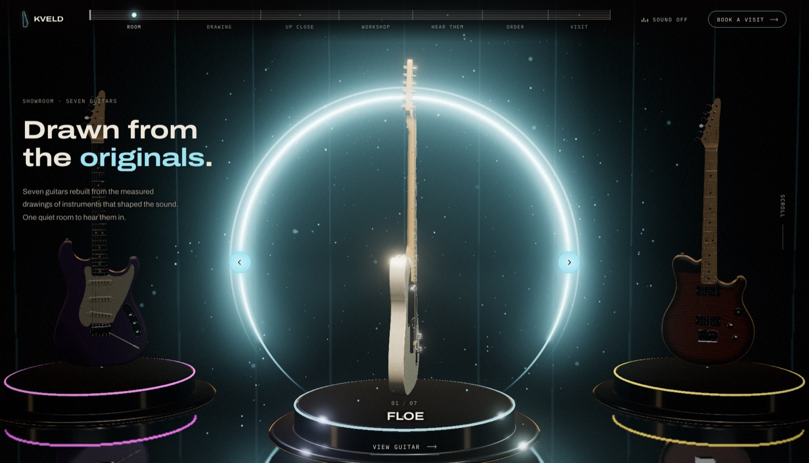

# KVELD: A 3D Showroom for Seven Guitars

Seven guitars on lit plinths in a dark room. Turn them in the hero, then scroll into a close-up tour, a plan drawn from the guitar's numbers, a workshop timeline, sound you can play and an order slip.

**Live:** https://sam1983aing.github.io/kveld/



KVELD is a fictional guitar maker, and the page is a concept study. Each guitar was rebuilt from published measured drawings of an instrument that shaped the sound, then changed enough to be KVELD's own (headstock, markers, logo, body lines). No real brand is affiliated.

## What's in it

- **The room.** Seven guitars in a ring over black glass, under a halo of light. Arrows or a drag turn the ring, View guitar opens a close-up you can turn by hand.
- **The tour.** Scrolling walks the camera around the centre guitar, with callouts on the part it's looking at.
- **The drawing.** The guitar's plan is plotted from the same numbers that built the model.
- **The workshop.** One bench, the weeks of the build, a word and a log line for each step.
- **Hear them.** Each guitar's sound, synthesized in the browser from a string model.
- **How to order.** The seven with weeks and prices, and a slip that draws the guitar as you go.

## How it's built

three.js r186 (Draco GLB models, a reflective floor, bloom and depth of field), GSAP ScrollTrigger and Lenis. The room opens once the three guitars in view are in and loads the other four behind it. It lowers its render resolution on slower machines.

This repository holds only the published page. `index.html` is a thin page: the code, the stylesheet, the models, stills, fonts and Draco decoder load from jsDelivr, pinned to a tag on [Sam1983Aing/aura-assets](https://github.com/Sam1983Aing/aura-assets/tree/1.25.0/kveld). The source lives in a separate private repository.

## Run it locally

```bash
python3 -m http.server 4173
```

Then open http://localhost:4173/ . It needs a network connection for the CDN. Without one, the page's words still show on a dark ground.

## Files

```text
index.html          the page (the code and assets come from the CDN)
assets/cover.png    800x600 cover, also the share image
assets/preview.jpg  the screenshot above
```

## Rights

All rights reserved. No licence is granted to reuse the code, models or images. The measured drawings the guitars were built from are not included here.
